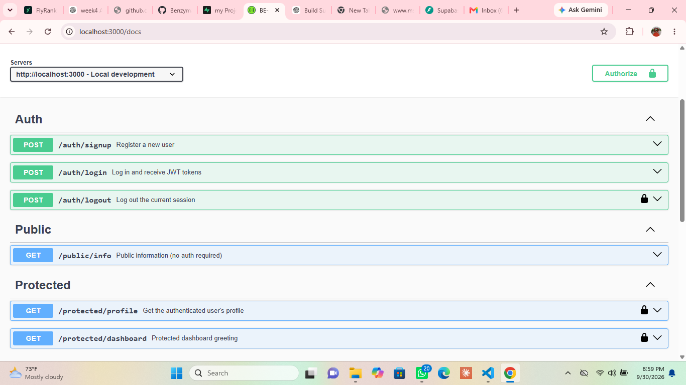

# FlyRank AI — Auth, Login & Protect API

A backend authentication project completed as part of the FlyRank AI Backend Track — Assignment A4: Auth · Login & Protect.

The project implements user registration and login with Supabase Auth, JWT bearer-token protection, reusable authentication middleware, protected API routes, logout, and interactive Swagger/OpenAPI documentation.

> Assignment note: The supplied assignment document labels this work as “WEEK 2 · ASSIGNMENT A4 Auth · Login & protect.” This repository is maintained as the Week 4 workstream in the project organization.

## Features

- User signup with email and password
- User login with Supabase Auth
- JWT access-token authentication
- Reusable bearer-token authentication middleware
- Protected profile endpoint
- Protected dashboard endpoint
- Protected logout endpoint
- Public API endpoint
- Invalid/tampered token rejection
- OpenAPI 3.0 specification
- Swagger UI with bearer authentication
- Environment-based Supabase configuration
- `.env.local` excluded from version control
- TypeScript implementation using Next.js Route Handlers

## Tech Stack

- **Next.js 16** — App Router and Route Handlers
- **TypeScript**
- **Supabase Auth** — identity and session management
- **@supabase/supabase-js**
- **Swagger UI** — interactive API documentation
- **OpenAPI 3.0.3**
- **Node.js / npm**

## Project Structure

```text
app/
├── auth/
│   ├── signup/route.ts
│   ├── login/route.ts
│   └── logout/route.ts
├── public/
│   └── info/route.ts
├── protected/
│   ├── profile/route.ts
│   └── dashboard/route.ts
└── docs/
    └── [[...path]]/

lib/
├── supabase.ts
└── auth-middleware.ts

openapi.json
.env.example
### Swagger UI Screenshot

